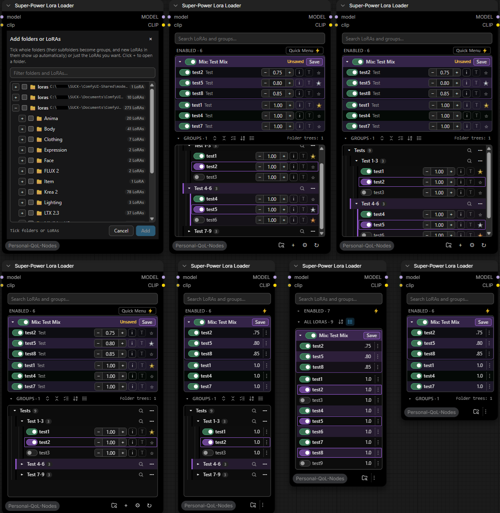
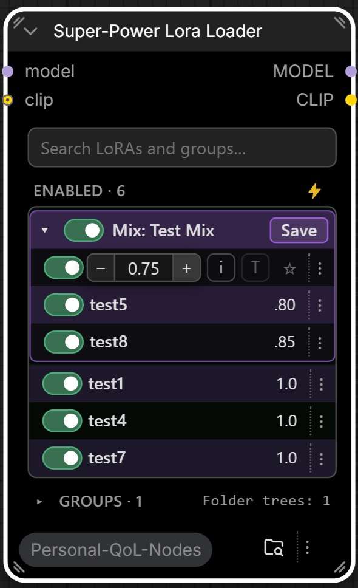
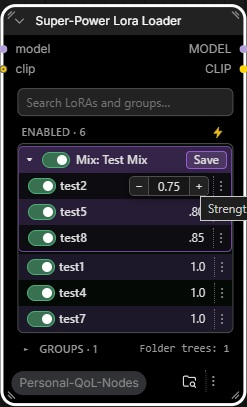
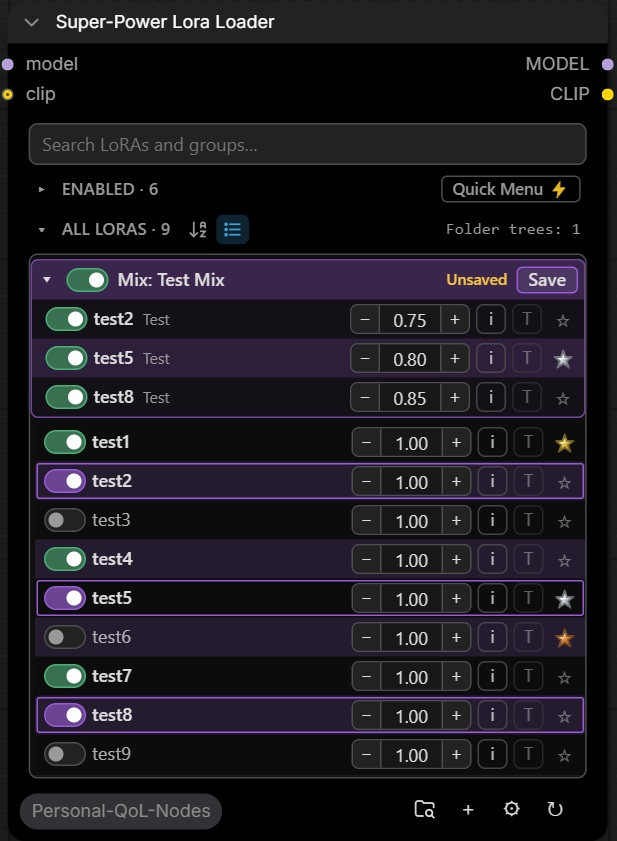
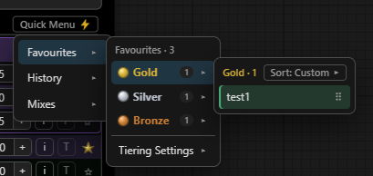
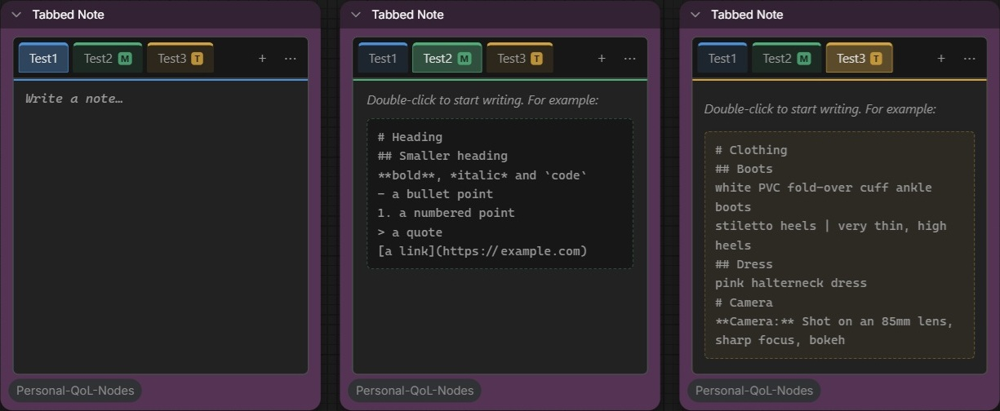
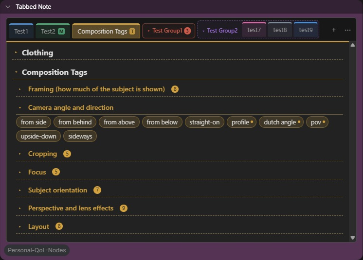
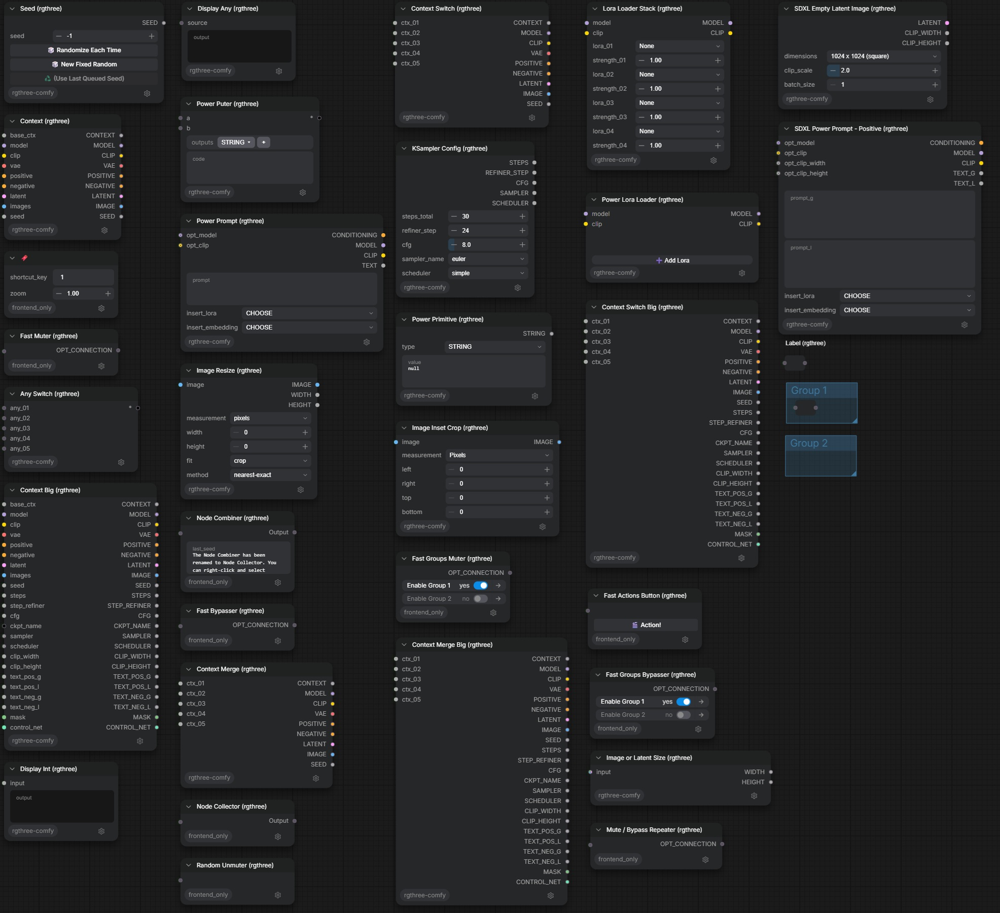

### Super-Power LoRA Loader:

A loRA loader built for crazy people far too many loRAs for even a single model, to effectively manage their horde of loRAs. 

*still in beta, so some things may change, but it should be just how functions are displayed rather than any fictionality additions or changes, feel free to throw in your 2 cents.* 

**All Modes and Compactions of the Same Node:**

.

every mode switch is 1 click, 2 clicks for one which will ask if you want it to be the default behaviour with a check box, then it gets out of your way and is 1 click.

Setup Wizard: automatically finds all `ComfyUI/model/loras` location—for those particularly masochistic individuals among us, that have multiple insistences of ComfyUI and refuse to have a centralised location for their models—and allows you to select all Folder trees and individual loras you want on dropping the node on the canvas.

**Narrow Mode:** 
Just drag the node narrow enough and it will automatically compact everything that needs compacting, everything is still accessible by hovering over the vertical "..." icons and in the case of model strength hover over the compact model strength.

. .

**Plain List mode:** 

while collapsing enabled can make it like the rgthree's Power Lora Loader, but with search, bookmarks, favourites, mixes and being able to move in whole folder trees of loras if you so choose, also limits you to 20 rows before enabling scrolling.

.

being real, you should just be using the narrow mode, maybe with groups collapsed, and just rely on search to find your loRAs, unless you have a small number of loRAs probably 10 or less. if you have more but want specific set of loras, just add all the loras for the model and use Mixes that’s exactly what that is for.

**Quick Menu, Favourites, History:**

.

Does what it says on the tin, quickly access Favourites, History and Mixes and make some limited changes to them. 

**Mixes:** 

probably the only thing I need to explain, a Mix here is a collection of loRAs you have added to the node, they save their strengths separately to the main strength, so you can load them in the way you have dialled them in to do what you want, in enabled or in list mode you can still enable loras that are in the Mix, doing this will grey out the lora in the mix and will not change the mixes strength, instead you will get the regular strength you have set for the lora, or default 1.00 if you have not entered a strength.

### TabbedNote:
For organising a Notes and Markdown Notes into a centralised location, all data kept within the workflow, 

.

**Tag List:** loosely based on a mix between Markdown Note and the chip system from the model info from rgthree Power Lora Loader, best used with model that rely on danbooru tags—Illustrious, Anima, and to some extent MOSS Image—to keep your go to tags and artists organised and easily accessible. 

also works for natural language prompt sections eg: `**Camera:** Shot with a Canon EOS R5 with an RF 85mm f/1.4L, shot at f/8, sharp focus, bokeh, very aesthetic` can be all one chip, or multiple chips so you can choose for example between bokeh or not, you could for example have a sub-title for the type of camera, lense, focal length and stop. so you can with 4 clicks you can build a camera setup, have other sub sections for different photography terms, it can be really powerful even with natural language when dealing with technical terms you will never remember, but are best used with natural language models. 

In fact I think I'm going to get an LLM to create such a list for me right now.

.

-  Click individual chips to copy them to clipboard.
-  Holding Shift + Click copies all clicked chips.
-  Clicking a title or sub-title will copy all the chips contained within the title / sub-title.

**Spell Check and Pysssss Integration:** Each tab can have Spell Check and Pysssss enabled/disabled though it's right click menu.

Oh almost forgot in the setting you can set it up to be a text prompt, uses the current tab by default, but you can set and unset a default tab, can also store text prompts automatically that are connected. I'm not using it this way, but... why not.

### Nodes 2.0 front-end patch for rgthree-comfy:
.

Why I have bothered? 

I noticed a generation speed increase with nodes 2.0 when you are having to block swap a lot with nodes 2.0 vs classic canvas and you get a lot less hitches in both the UI and the model it's self when dragging the canvas, like with a video model on a 16GB card when pushing resolution and length to the limits. Admittedly you do get a lower canvas FPS, but hitches are much worse than low FPS, and generation speed is even more important, if you have plenty of VRAM pleas ignore, *jealousy intensifying.* Think it has something to do with how the classic canvas redraws everything as you drag the canvas. At any rate it only took a couple of hours and about 10-15% of my weekly Claude usage allowance, so meh.

#### Reload between switches between classic canvas and notes 2.0!

  *Gets a lot less complicated, but much more boring and/or niche here for sure, so in order of least boring and niche, although they're self explanatory basic nodes so no picture.*

### Resolution Picker:
  set megapixel, aspect ratio, orientation and divisible by, with live output resolution preview, there is a node out there that is basically this minus the orientation, but I find a separate orientation setting to be useful, allows for more aspect ratios in a shorter list.
-Included aspect ratios: 1:1, 5:4, 4:3, 1.414:1, 3:2, 5:3, 16:9, 2:1, 21:9, 2.39:1, 3:1.

### Seed History: 
Find yourself realising you had a good seed, but now you have lost it, feed your seed into this node and keep a history, so you never have to regret losing a seed again. *Will likely add a combined seed generator with history.*

### Sigmas at Step:
Useful for nodes that use a sigmas value to activate or deactivate in an intuitive manner.

### Sigmas at Percent:
Same as sigmas at step, but this time with percentages, actually less useful, but I created it so... why not add it, someone might find a use case where it's more useful.

### Force Changed
Useful when you have stateful nodes which don't reset on completion of the generation, literally the only reason for this node, but when it comes in handy, it's so handy. Just wire it in before the stateful node and it will registerer the text or seed change and force an is_changed for everything after the node.

*All nodes made with Claude so if you don't like AI, it's fine, just don't use it, but I will say that I have spent like 14 roads of coding with Claude to get the lora loader how I like it, and I think 6 for the tabbednote, so it's not just AI slop. IT'S REFINED AI SLOP, DAMMIT!*
